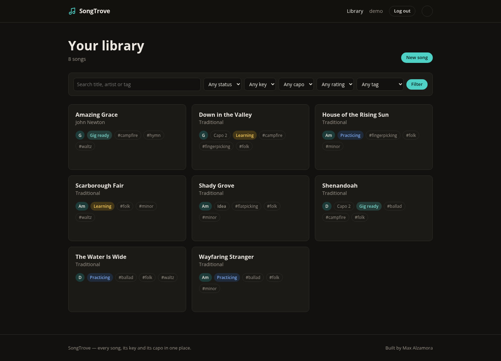
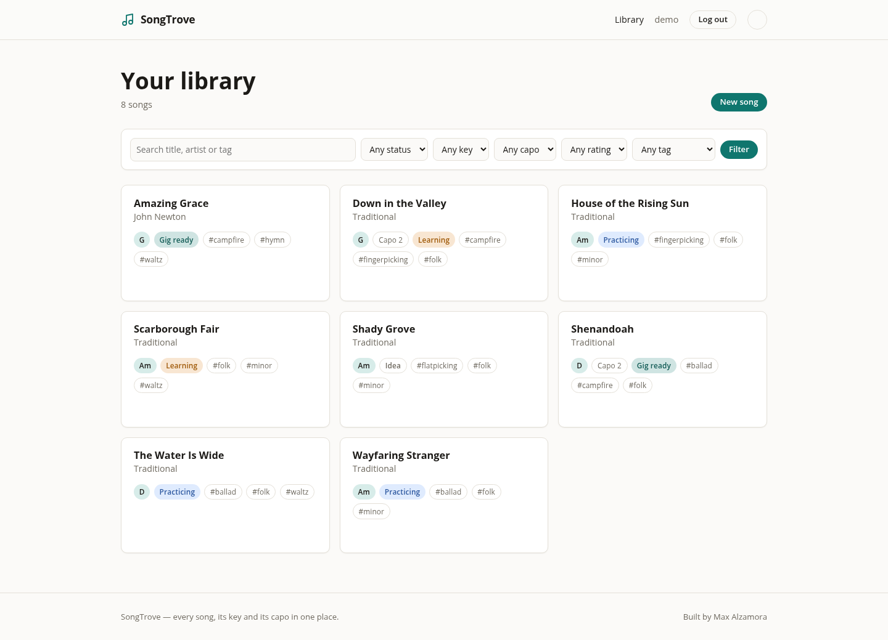
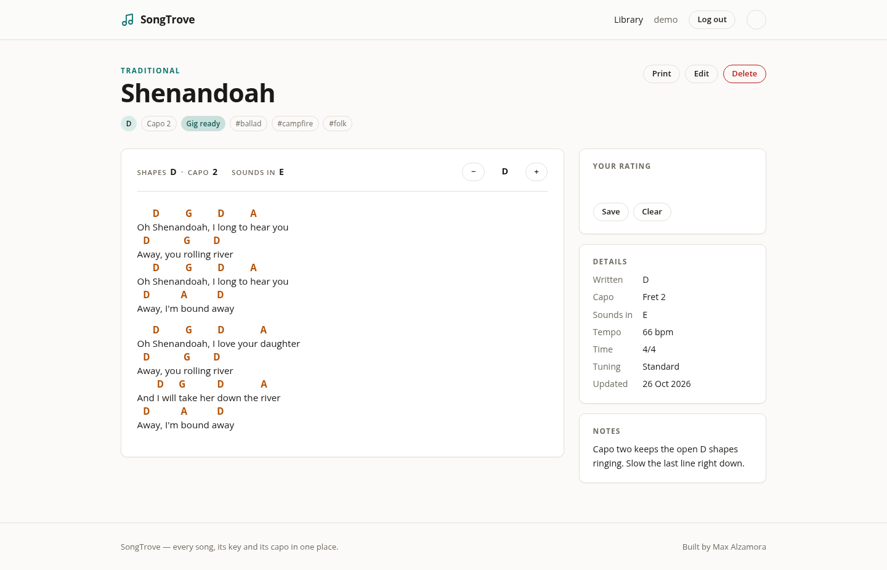
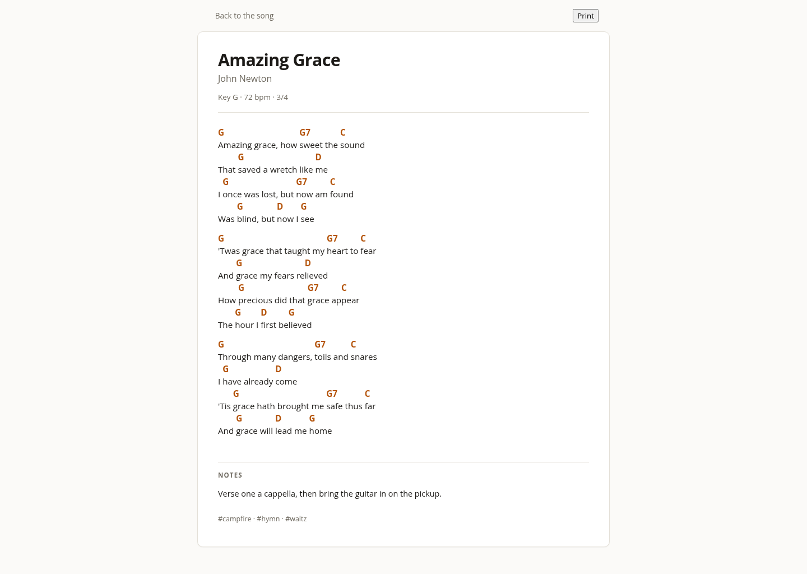
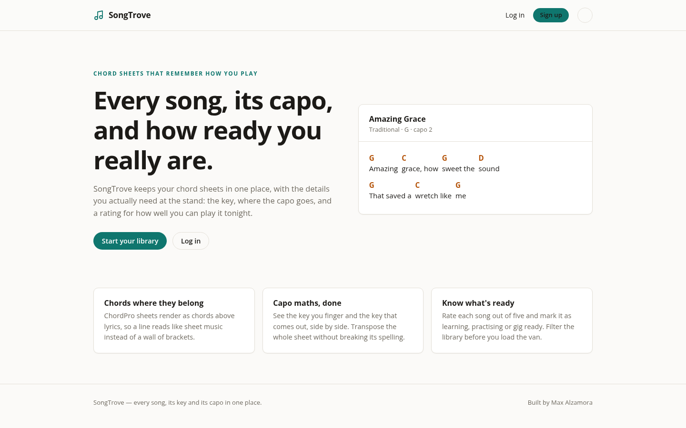

# SongTrove

**A private chord sheet library for the songs you actually play.**

SongTrove keeps the chords, capo position and practice notes for every song in
your repertoire in one quiet place. It reads ChordPro (`[Am]lyrics`) and the
plain chords-above-lyrics sheets you copied out of an old songbook, transposes
on the fly, and tells you what a capo will do to the key before you clamp it on.

[](https://github.com/maxalzamora/songtrove/actions/workflows/ci.yml)



## What it does

- **A library per account.** Sign up, sign in, and every song you add is yours
  alone. Nothing is shared or public.
- **Two sheet formats.** ChordPro for new sheets, and a plain-text importer
  that finds the chord lines in a songbook-style sheet and converts them on
  the way in.
- **Chords above the right syllable.** Sheets render as aligned columns, not a
  wall of brackets, and long lines scroll instead of wrapping mid-word.
- **Transpose without saving it.** Move a song up or down and the key, the
  chords and the capo hint all follow. Reload and the song is back in its
  written key, because transposition is a view, not a change.
- **Capo arithmetic that matches the fretboard.** A song is stored in the key
  of the shapes you finger. With a capo on fret 2 and D shapes, SongTrove says
  "Sounds in E", because that is what the room hears.
- **Practice state that means something.** A one-to-five star performance
  rating, a status from *Idea* to *Gig ready*, tags, tempo and tuning.
- **Search and filter.** Find a song by title, artist, lyrics or notes, then
  narrow by key, status, rating and tag.
- **A print view.** One page, no navigation, no buttons, black on white. The
  transpose you picked on screen is the transpose that prints.
- **Light, dark, or whatever the system says.** Three-state theme toggle with
  no flash of the wrong colours on load.
- **Responsive.** Works on a phone at the music stand, where the capo and
  transpose controls matter most.

## Screenshots

| The library | A song with a capo |
| --- | --- |
|  |  |

| Print view | Landing page |
| --- | --- |
|  |  |

## Running it locally

SongTrove needs Python 3.12 or newer. Local development uses SQLite, so there
is no database to install.

```bash
git clone https://github.com/maxalzamora/songtrove.git
cd songtrove
python -m venv .venv
source .venv/bin/activate
pip install -r requirements.txt

python manage.py migrate
python manage.py createsuperuser
python manage.py seed_songs --user <your username>   # optional: eight public-domain songs
python manage.py runserver
```

Open <http://127.0.0.1:8000>, land on the sign-in page, and use the account you
just created.

`seed_songs` is safe to run more than once: it skips songs already in the
account and reuses tags regardless of how they are capitalised.

## Tests

```bash
pytest
```

The suite covers the chord parser, transposition, capo arithmetic, rendering,
both sheet formats, every view, ownership rules, the rating endpoint, the seed
command and the admin. It runs against SQLite in a few seconds.

For a coverage report:

```bash
pytest --cov=songs --cov=accounts --cov=config --cov-report=term-missing
```

Coverage sits at 98%; the only untouched code is the production and ASGI entry
points, which need a real MySQL server to mean anything.

Continuous integration runs the same checks on GitHub Actions for every push
and pull request, including a failure if a model change is missing its
migration.

## How the interesting parts work

### The sheet is data, not HTML

`songs/chords/parser.py` turns a sheet into lines of segments: each segment
carries a chord and the lyric text it sits above. Rendering then places the
chord in a block over its syllable, with the spaces inside the lyric preserved.
That is why `[G]Amazing [C]grace` lines up the way a handwritten sheet does,
and why the same parse feeds the transposer, the plain-text converter and the
print view.

### Capo keys

A capo changes the sound, not the fingering. SongTrove stores the key of the
shapes written on the sheet, and derives the sounding key:

```
sounding key = written key + capo
written key  = sounding key − capo
```

So a sheet in F shapes with the capo on fret 2 is shown as **"Shapes F · Capo
2 → Sounds in G"**. When you transpose the song, both keys move together and
the capo stays where you set it.

### Transposing is a view

`?transpose=n` moves a song by `n` semitones, normalised to the range −6…+5 so
there is always one shortest direction. Nothing is written to the database.
Accidentals follow the key: flats stay flat, and a chord with no accidental of
its own lands on the spelling guitarists reach for (Eb, not D#).

### No build step

Server-rendered Django templates, one small JavaScript file for the theme
toggle, hand-written CSS with `light-dark()` tokens. No Node, no bundler, no
framework. The page that ships is the page in the repository.

## Project layout

```
config/            settings (base, dev, prod), root URLs, health check
accounts/          signup, login, logout
songs/
  chords/          parser, theory, transpose, capo, render, plain-text convert
  management/      seed_songs command
  templatetags/    
  tests/           the suite
  models.py        Song and Tag, per-user ownership
static/            CSS and the theme toggle
templates/         base layout and the landing page
docs/DEPLOY.md     PythonAnywhere + MySQL walkthrough
```

## Production

The production settings use MySQL through PyMySQL, WhiteNoise for compressed
static files, secure cookies, HSTS and HTTPS redirects. `docs/DEPLOY.md` is a
step-by-step guide to running it on PythonAnywhere's free tier, including the
two traps of that tier: the three-month MySQL renewal and the missing static
directory.

A `/healthz/` endpoint reports `ok`, or `503` when the database cannot answer,
so an uptime monitor can tell a real outage from a slow page.

## Scope

This is deliberately a small app. Version one has no setlists, no performance
history log and no sharing between accounts. The goal is a tool that is quick
to open on a phone before a song, not a platform.
